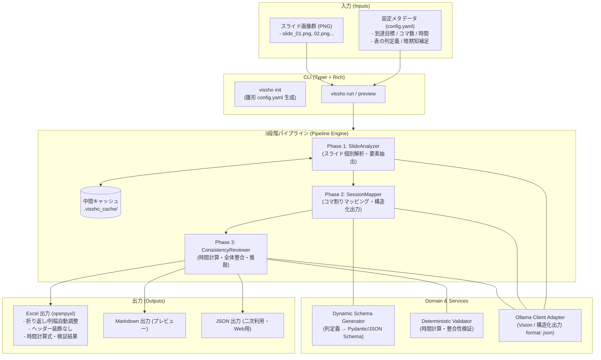

# AGENTS.md - vissho 設計・開発仕様書（深化版）

## 1. 概要

`vissho` は、既存の学習資料を画像化したものから、Ollama 経由で vision 対応の LLM を活用して、授業の学習指導案の作成を支援する CLI ツールです。

## 2. 目的・解決する問題

- **資料と指導案の乖離解消**: 学習資料は存在するが、経年変化による修正事項が学習指導案に反映されておらず、乖離が発生している問題を解決する。
- **暗黙知の形式知化**: スライドに書かれていない作成者・担当教員の補足説明や指導上の留意点（暗黙知）を構造化し、他者や将来の自分が再利用可能な指導案として文章化する。

---

## 3. システムアーキテクチャ

### 3.1 基本設計方針
1. **パイプライン型 + ポーツ＆アダプタ（Hexagonal）構成**
   - 3段階の中間処理（Phase 1: 個別解析 → Phase 2: マッピング → Phase 3: 整合・推敲）を独立したパイプラインステージとして分離。
   - LLM（Ollama）、ファイル IO（画像・YAML）、出力（Excel / Markdown）をアダプタとして疎結合化し、テスト容易性と拡張性を担保。
2. **動的スキーマ生成（Dynamic Pydantic Schema）**
   - `config.yaml` で定義された「出力表の列定義」に基づき、実行時に Pydantic モデルおよび Ollama 向け JSON Schema を動的生成。
3. **決定論的検証（Deterministic Rules）と LLM の協調**
   - コマごとの時間合計やスライド番号の参照網羅性は Python コードで厳密に計算・検証し、文脈の推敲や展開の整合性を LLM に任せるハイブリッド方式。
4. **中間成果物のキャッシュとトレーサビリティ**
   - スライド解析結果（Phase 1）を画像ハッシュ（MD5/SHA256）とともにローカル保存し、再実行時の推論コストを最小化。
   - 全行に出典スライド番号（`source_slide_numbers`）を付与し、完全なトレーサビリティを確保。

### 3.2 アーキテクチャ図



### 3.3 プロジェクト・ディレクトリ構成

```text
vissho/
├── AGENTS.md
├── pyproject.toml              # uv / パッケージ依存管理
├── src/
│   └── vissho/
│       ├── __init__.py
│       ├── cli.py              # CLI エントリーポイント (Typer)
│       ├── config.py           # config.yaml 用 Pydantic モデル & デフォルトテンプレート
│       ├── core/
│       │   ├── schema.py       # 動的 Pydantic スキーマ生成
│       │   └── validator.py    # 時間・コマ数・スライド参照の整合性検証
│       ├── pipeline/
│       │   ├── orchestrator.py # 3段階パイプライン制御
│       │   ├── phase1_analyze.py  # スライド個別解析
│       │   ├── phase2_map.py      # コマ割りマッピング
│       │   └── phase3_review.py   # 全体整合・推敲
│       ├── llm/
│       │   ├── client.py       # Ollama API 連携 (Vision / format: json)
│       │   └── prompts/        # Jinja2 プロンプトテンプレート
│       ├── exporter/
│       │   ├── excel.py        # openpyxl による Excel 出力 (装飾なし・折り返し・数式)
│       │   ├── markdown.py     # プレビュー用 Markdown 出力
│       │   └── json_export.py  # 二次利用・Web UI 向け JSON 出力
│       └── utils/
│           ├── cache.py        # 画像ハッシュキャッシュ
│           └── image.py        # 画像読み込み & スライド番号抽出
└── tests/
```

### 3.4 技術スタック
- **言語・パッケージ管理**: Python 3.12+ / `uv`
- **CLI**: `Typer` + `Rich`（進捗バー・リッチ出力）
- **バリデーション / スキーマ**: `Pydantic v2`（`create_model` による動的スキーマ生成）
- **LLM / Vision**: `ollama` Python SDK（または `httpx` による Ollama REST API 呼び出し）
- **プロンプト管理**: `Jinja2`
- **Excel 出力**: `openpyxl`
- **テスト**: `pytest`

---

## 4. コマンドラインインターフェース (CLI)

### 4.1 コマンド一覧
- `vissho init`: カレントディレクトリに `config.yaml` の雛形を配置。
- `vissho run`: 指定した設定とスライド画像群から学習指導案を生成（全パイプライン実行）。
- `vissho analyze`: Phase 1（スライド個別解析）のみを実行しキャッシュに保存。
- `vissho preview`: 生成結果または中間結果をターミナルや Markdown でプレビュー表示。

### 4.2 `vissho init` 仕様
- **目的**: ユーザーが設定ファイルを手動でゼロから作成する負担を軽減し、必要な項目を網羅した雛形を提供する。
- **動作**:
  - カレントディレクトリに `config.yaml` を新規作成する。
  - すでに同名ファイルが存在する場合は上書きせずエラー（または警告）とし、`--force` フラグが指定された場合のみ上書きを許可する。
  - 雛形には、教育の前提情報、列定義（初期おすすめ定義）、補足暗黙知の記述例、各設定値の説明コメントを含む。

---

## 5. 入力仕様

### 5.1 設定メタデータファイル (`config.yaml`)
YAML（または JSON）形式で以下の要素を定義する。

```yaml
# vissho 設定ファイル (config.yaml)

# 教育の前提情報
prerequisites:
  purpose: "〇〇技術の基礎概念を理解し、簡単なアプリケーションを自力で構築できる。"
  target_audience: "情報系専門学校 1年生（基礎的なプログラミング知識を有する）"
  prerequisite_knowledge: "Python の基本文法（変数、関数、制御構文）"
  total_sessions: 4       # コマ数
  session_minutes: 90     # 1コマあたりの時間（分）
  rubric:
    - grade: "A"
      criteria: "〇〇の概念を正しく理解し、発展的な課題を独力で解決できる。"
    - grade: "B"
      criteria: "指示に従って基本機能を実装できる。"
    - grade: "C"
      criteria: "基本用語を理解しているが、実装には補助が必要である。"

# 出力する表の列定義
columns:
  - name: "session_number"
    description: "コマ番号（例: 第1コマ）"
    width: 12
  - name: "topic"
    description: "単元・大項目"
    width: 20
  - name: "learning_objectives"
    description: "学生の到達目標・ねらい"
    width: 30
  - name: "activities"
    description: "具体的な学習活動・授業展開"
    width: 40
  - name: "allocated_minutes"
    description: "配当時間（分）"
    width: 12
  - name: "remarks"
    description: "指導上の留意点・準備物・教員の補足説明（暗黙知）"
    width: 30
  - name: "source_slides"
    description: "出典スライド番号一覧"
    width: 16

# 補足・暗黙知の入力（オプション: スライド画像だけでは読み取れない教員の補足説明）
supplementary_notes:
  - slide_number: 5
    note: "ここの図は受講生がつまずきやすいので、板書で具体例を補足して説明する。"
  - slide_number: 12
    note: "時間が押しやすいため、演習課題の一部は持ち帰り宿題としてもよい。"
```

### 5.2 スライド画像ファイル
- PNG 形式を基準とする。
- ファイル名（basename）の末尾にスライド番号を含むこと（例: `slide_01.png`, `01.png`, `lecture-page-12.png`）。

---

## 6. 中間処理（3段階パイプライン）

長大な資料におけるコンテキスト制限やハルシネーションを防ぐため、以下の 3 段階で処理を行う。

### フェーズ 1: 各スライドの要素抽出（個別解析）
- スライド画像を順次読み込み、各スライドが何を教えているか（概念、キーワード、所要時間の目安など）を個別に抽出する。
- スライド画像に紐づく補足テキスト（暗黙知）が存在する場合は、併せてプロンプトに注入する。
- 画像ハッシュと解析結果をキャッシュ（`.vissho_cache/`）に保存し、差分実行を可能にする。

### フェーズ 2: コマ割りへのマッピング・グループ化
- `config.yaml` の列定義から Pydantic の `create_model` 等を用いて動的 JSON スキーマを定義し、Ollama の構造化出力（`format: json`）を活用する。
- 抽出された要素を指定されたコマ数・時間数に合わせて配分・グループ化する。
- どのスライドのどの要素に基づいているか（出典のスライド番号）のトレーサビリティを保持する。

### フェーズ 3: 全体整合・推敲
- **プログラムによる検証**: 各コマの時間合計が前提条件（`session_minutes`）と一致しているか、未割当のスライドがないかを検証する。
- **LLM による推敲**: 全体の流れに矛盾がないか、学生の到達目標や難易度カーブに沿っているかを推敲し、必要に応じて整合性を取る。

---

## 7. 出力仕様

### 7.1 Excel (`openpyxl`) 出力
- 構造化されたデータを表形式で出力する。
- 複数行にわたるテキストに対する「折り返して全体を表示する（Wrap Text）」設定を適用する。
- メタデータの `width` 定義および行数に応じた適切な行高・列幅の自動調整を行う。
- **※ヘッダー行の背景色や太字設定は行わない**（現場の指定フォーマットやトナー消費、既存テンプレートとの調和を重視）。
- 各コマの時間合計の自動計算（Excel の `SUM` 数式等）やバリデーション結果を含める。

### 7.2 プレビュー・二次利用
- 確認用の Markdown 形式での出力を標準サポートする。
- ブラウザ上でのプレビュー・微調整や、将来的な Web UI 連携を視野に入れた構造化 JSON 出力も保持する。
